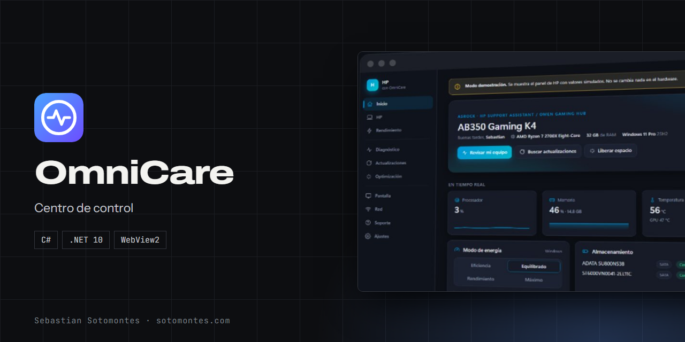
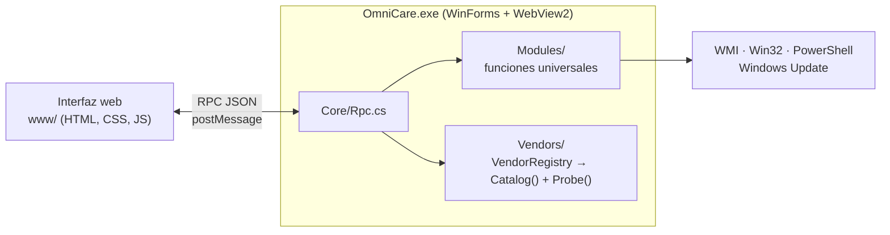

<p align="center"></p>

<p align="center">Centro de control para Windows: rendimiento, batería, diagnóstico y actualizaciones, con funciones específicas por marca de equipo.</p>

<p align="center"><a href="https://sotomontes.com/#omnicare"><b>Ver en sotomontes.com</b></a> · <a href="#cómo-se-usa">Cómo se usa</a> · <a href="#cómo-funciona-por-dentro">Cómo funciona</a> · <a href="#novedades">Novedades</a></p>

| Ficha técnica | |
|---|---|
| **Autor** | Sebastian Sotomontes |
| **Tipo** | Centro de control |
| **Plataforma** | Windows 10 y 11 |
| **Versión** | 0.1.0 |
| **Estado** | En desarrollo |
| **Stack** | C# · .NET 10 · WebView2 |
| **Código** | Privado. Esta página es solo una presentación. |

---

## Qué es

OmniCare es un centro de control para cualquier PC con Windows. En vez de instalar la utilidad de cada fabricante, una sola app muestra el estado del equipo, lo diagnostica y lo mantiene. Al detectar la marca activa sus funciones propias y adopta sus colores.

<p align="center"></p>

## Novedades

- Primera versión con funciones para ocho marcas de equipos.

## Cómo se usa

1. Abre OmniCare. **Inicio** muestra en tiempo real CPU, memoria, temperatura, ventiladores, discos y red, con una puntuación de salud.
2. Pulsa **Revisar mi equipo** para analizarlo, o entra en **Diagnóstico** para ver discos, memoria, controladores con problemas, pantallazos azules y apagados inesperados.
3. En **Actualizaciones** revisa Windows Update y los controladores.
4. En **Optimización** libera espacio y decide qué aplicaciones arrancan con Windows.
5. Entra en la sección de tu marca para ajustar modos de rendimiento, carga de batería, teclado o ventiladores.
6. En **Ajustes** elige tema de marca, modo claro u oscuro.

## Funciones

- **Inicio** con CPU, memoria, temperatura, ventiladores, discos y red en tiempo real, y puntuación de salud.
- **Diagnóstico**: estado SMART, controladores con problemas, pantallazos azules y apagados inesperados.
- **Actualizaciones** de Windows y de controladores.
- **Optimización**: limpieza de temporales y aplicaciones de inicio.
- **Energía, pantalla y red** en un solo lugar.
- **Funciones por marca** para equipos ASUS, Lenovo, Dell, HP, Acer, MSI, Samsung y Surface.

## Detalles

- ASUS: modos de rendimiento, límite de carga, GPU Eco, MUX y teclado.
- Lenovo: modo de rendimiento, carga normal, conservación o rápida, y opciones de BIOS en ThinkPad.
- Dell y HP: gestión térmica, carga, ventiladores y opciones de BIOS según el modelo.
- Acer, MSI y Surface: rendimiento, ventiladores o modo de carga según el modelo.
- Cada función comprueba si tu modelo la admite; si no, aparece desactivada con el motivo.
- Prueba de red con latencia, DNS y velocidad aproximada.

## Cómo funciona por dentro

### Funciones por marca

| Marca | Funciones |
|---|---|
| ASUS | Modo Silencioso/Equilibrado/Turbo, límite de carga, GPU Eco, MUX, Panel Overdrive, teclado (TUF/Vivobook), bloqueo Fn, temperaturas y ventiladores |
| Lenovo | Modo de rendimiento (Fn+Q), carga Normal/Conservación/Rápida, modo híbrido, overdrive, bloqueo de touchpad y tecla Windows, opciones de BIOS de ThinkPad |
| Dell | Gestión térmica, configuración de carga (incl. inicio/fin personalizados), teclado, bloqueo Fn: lo que exponga la BIOS |
| HP | Modo térmico OMEN/Victus (v0/v1), ventiladores al máximo, retroiluminación, modo de gráficos, temperatura y ventiladores, opciones de BIOS (Battery Health Manager…) |
| Acer | Modo de rendimiento Predator/Nitro, ventiladores auto/máximo |
| MSI | Lectura de ventiladores |
| Surface | Modo de carga (adaptativa / límite 80 %) |
| Samsung | Solo enlaces + funciones generales |

### Arquitectura



- **Host nativo** en C# (.NET 10, WinForms) con la interfaz en **WebView2**. La UI llama al backend mediante un RPC JSON (`Core/Rpc.cs`).
- **Módulos universales** (`Modules/`): batería, limpieza, diagnóstico, pantalla, estadísticas en vivo, red, energía, inicio, información del sistema y actualizaciones.
- **Módulos de marca** (`Vendors/`): cada fabricante expone un `Catalog()` (qué funciones existen) y un `Probe()` (cuáles admite este equipo). `VendorRegistry` elige el módulo según el fabricante de la placa.
- **Ejecutable único** autocontenido (~44 MB): no hace falta instalar .NET.

```
src/OmniCare/
├── Core/        Rpc, Wmi, Native (P/Invoke), Sys, Log
├── Modules/     Battery, Cleanup, Diagnostics, Display, LiveStats, Network, Power, Startup, SystemInfo, Updates
├── Vendors/     Asus, Lenovo, Dell/HP, Otros (Acer, MSI, Surface, Samsung), BiosAttributes, VendorRegistry
├── www/         index.html, app.js, app.css, icons.js
└── MainForm.cs, Installer.cs, Program.cs
```

---

<sub>© 2026 Sebastian Sotomontes. Todos los derechos reservados.</sub>
