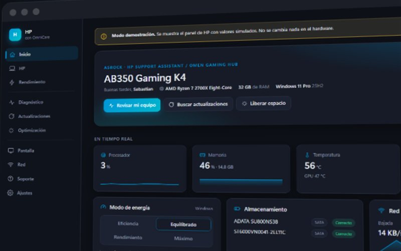

<h1 align="center">OmniCare</h1>

Centro de control para Windows: rendimiento, batería, diagnóstico y actualizaciones, con funciones específicas por marca de equipo.

<a href="https://sotomontes.com/#omnicare"><b>Ver en sotomontes.com</b></a>

**Autor:** Sebastian Sotomontes · © 2026

> Esta página es solo una presentación del proyecto. El código y los instaladores son privados.

---

## Funciones

- **Inicio** con CPU, memoria, temperatura, ventiladores, discos y red en tiempo real, y puntuación de salud.
- **Diagnóstico**: estado SMART, controladores con problemas, pantallazos azules y apagados inesperados.
- **Actualizaciones** de Windows y de controladores.
- **Optimización**: limpieza de temporales y aplicaciones de inicio.
- **Energía, pantalla y red** en un solo lugar.
- **Funciones por marca** para equipos ASUS, Lenovo, Dell, HP, Acer, MSI, Samsung y Surface.

## Tecnologías

C# · .NET 10 · WebView2

© 2026 Sebastian Sotomontes. Todos los derechos reservados.
